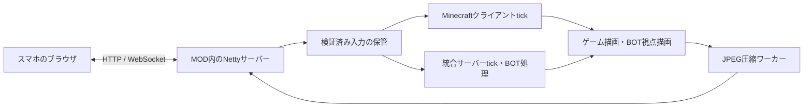
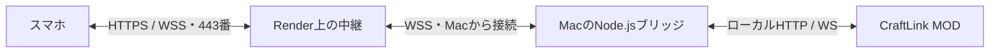

# CraftLinkの実装の仕組み

[READMEへ戻る](../README.md) · [操作・設定の詳細](USER_GUIDE.md)

## 全体構成

Minecraft Java 1.20.1・Forge 47.4.10・Java 17を使用します。スマホ側はHTML／CSS／TypeScriptです。Web画面をViteでビルドし、MODのJARへ同梱しています。スマホへの専用アプリは不要です。

通信の受信、ゲームの更新、映像の描画、画像圧縮を分離しています。通信スレッドからプレイヤーやワールドを直接書き換えません。

## 2種類の操作モード

| モード | 操作先 | 対応環境 | 標準ポート |
| --- | --- | --- | --- |
| 通常コントローラー | PCでログインしているプレイヤー | シングルプレイ・通常のマルチプレイヤー | 8765 |
| みんなで参加 | スマホごとに別のBOT | このMODを動かすPCの統合サーバー | 8766 |

BOTは専用の人型エンティティです。Minecraftアカウントでログインした別プレイヤーや、外部サーバーへ接続する独立クライアントではありません。最大8端末が参加でき、各端末へ別々の参加ID・入力・持ち物・BOTを割り当てます。

## 接続・QRコード

1. F8画面で開始すると、HTTP／WebSocketサーバーを非同期で起動します。
2. 推測困難な256bitの一時トークンを生成します。有効期限は30分です。
3. 接続先・ポート・トークンを含むURLからZXingでQRを生成します。
4. スマホはHTTPで同梱Web画面を取得し、WebSocketのhelloでトークンを送ります。
5. 通常モードはPCで承認、BOT参加モードは有効なQRから即時参加します。

トークンはURLのフラグメントへ入れ、最初のHTTPリクエストのパスには含めません。QR再発行で古いセッションを無効化します。QRは接続先を伝えるもので、通信経路自体を作る機能ではありません。

学校用起動は利用者が明示的に選ぶ起動プロファイルです。保存済みの中継設定で接続し、ワールドの準備後に参加受付・QR表示を開始します。通常起動ではサーバーを自動開始しません。

## LAN・USB・インターネット中継

- **LAN**：ブラウザからPCのローカルHTTP／WSへ直接接続します。
- **Android USB**：ADBのreverse転送で、スマホの127.0.0.1からPCへ接続します。作成した転送だけを終了時に片付けます。
- **インターネット**：Macとスマホの両方が公開中継へ外向きに接続します。

`relay/server.mjs` が公開側、`relay/bridge.mjs` がMac側の中継処理です。`relay/school.mjs` が接続・Minecraft起動・再接続・終了処理をまとめます。中継認証キーとゲーム参加トークンは別です。キーはローカルの `.craftlink/school.json` に保存し、Gitへ含めません。

GitHubはソース管理とRenderへの配布元です。GitHub PagesをWebSocketサーバーとして使う構成ではありません。学校側が中継ドメインやWebSocketを遮断すると接続できず、その制限を回避する保証はありません。無料中継には休止・通信量などの制約があります。

## 通常プレイヤーの入力

ブラウザのPointer Eventsで複数の指を管理します。移動の継続状態、視点の差分、ボタンの押下・解放をWebSocketで送ります。状態変化時は即時送信し、継続状態も定期送信します。

`RemoteState` が上限付きで入力を保管し、`InputBridge` がクライアントtickで取り出します。`RemoteInput` はPC本来の入力を保持し、スマホの移動意図を合成します。同方向の入力で移動速度が倍になることはありません。

キーボードやOSマウスの疑似押下は行いません。攻撃・使用はMinecraftの通常ルーチンを呼び出し、継続掘削やダッシュ意図はMixinで統合します。通常モードのゲームルールやサーバーの判定に従います。

## BOTの生成・移動・ゲーム操作

`ClassroomRoom` が端末ごとの状態を管理します。`ClassroomBots` が統合サーバーのtickで読み取り、`ClassroomBot` を生成・更新します。出現位置は参加開始地点の周辺から地面と空間を調べて選びます。

移動・重力・衝突はエンティティの処理を使います。参加受付側でサバイバル／クリエイティブを選べます。クリエイティブ飛行、上昇・下降、スニーク、ダッシュ、設定に応じた自動ジャンプ、水泳を扱います。

ブロック操作は `BotBlockActions` が担当します。BOTごとのFakePlayerと `ServerPlayerGameMode` を利用し、破壊時間・道具の耐久・アイテム消費・Forgeの操作イベントを通します。FakePlayerは操作判定用で、見えるBOTとは別です。すべてのプレイヤー機能・第三者MODとの同等動作を保証するものではありません。

タップは使用／設置、長押しは攻撃／採掘、ドラッグは視点変更へ分けます。`BotTouchRay` が表示した映像のカメラ位置・向きとタップ座標からレイを計算します。古すぎるフレームや、撮影時から大きく移動した状態でのタップは拒否します。

## BOT視点の映像

スマホでMinecraftを動かす構成ではなく、PCで描画した映像をスマホへ送ります。

1. `BotVideoStreamer` が接続中のBOTを順に選びます。
2. Minecraftのカメラと描画先を一時的にBOT用へ切り替え、別のフレームバッファへワールドを描画します。
3. `BotFirstPersonRenderer` が腕と持ったアイテムを描画します。
4. 描画結果を読み取り、カメラ・描画先・OpenGL状態を復元します。
5. ワーカースレッドでJPEG圧縮し、フレーム情報と画像をWebSocketで送ります。
6. ブラウザが画像を表示し、受信確認（ACK）を返します。

録画ファイル・WebRTC・音声配信は使っていません。参加者全体で最大20回/秒のキャプチャに制限し、未確認フレームを積み続けない設計です。端末数が増えると各端末の更新頻度は下がります。GPU描画と画像読み取り自体は描画スレッドで必要なので、PC負荷を完全に非同期化できるわけではありません。

`VideoRenderState` と `PoseStackSnapshot` で描画状態を保存・復元し、BOT描画がPC側の画面へ残らないようにします。FabulousやシェーダーMODは未対応／未検証です。

## インベントリ・見た目・操作設定

- **持ち物**：BOTの実際のインベントリを送信し、選択・装備・ドロップをサーバー側で処理します。
- **クリエイティブタブ**：`CreativeCatalog` がMinecraftと導入MODのタブを取得します。取得要求は参加側のモード・登録項目を確認します。
- **アイテム画像**：`ItemIcons` がMinecraftのモデルを描画し、透過PNGとしてキャッシュして送ります。
- **名前**：`ParticipantProfile` が日本語対応・最大16文字で検証します。参加番号も表示します。
- **スキン**：標準9種類と自動選択です。サーバーで選択番号を同期し、本体と一人称の腕へ反映します。`SkinCatalog` はローカルのスキン素材から顔プレビューを作ります。
- **スマホ設定**：ジョイスティック／D-Pad、タップ／クロスヘア、感度、長押し時間、ボタンの位置・大きさ・透明度などをブラウザへ保存します。

名前やスキンはMicrosoftアカウントを変更しません。任意PNGのアップロードや外部スキンURLの読み込みは実装していません。

## 切断・負荷・安全処理

入力の長さ・頻度・操作名・数値範囲・接続Originを検査します。入力は最新状態を中心に保持し、通信遅延で無制限に操作が積み上がらないようにします。

入力が750ms途絶えると押下状態を解除します。切断・全員停止でも操作を解除します。BOT参加は個別の再接続情報で30秒以内なら同じBOTを引き継ぎます。F9は参加者全員の操作を停止するためのキーです。

LANのHTTP／WSは暗号化されません。遠隔接続ではHTTPS／WSS中継を使用します。任意OSコマンド・任意キー入力・自由なファイル操作を送るAPIは用意していません。

## コードの場所

| 場所 | 担当 |
| --- | --- |
| `src/main/java/dev/craftlink/CraftLink.java` | Forge初期化、tick、起動・終了の連携 |
| `gui/`・`config/` | Minecraft内画面・設定 |
| `network/`・`security/` | 通常接続、HTTP／WS、セッション |
| `input/`・`mixin/` | PCプレイヤーの独立入力・ゲーム処理との接続 |
| `classroom/` | 参加管理、BOT、ゲーム操作、プロフィール |
| `video/` | 映像・アイテム画像・描画状態復元 |
| `addon/` | MODが明示登録した操作の拡張API |
| `web/src/`・`web/src/classroom/` | 通常／BOT用コントローラー |
| `relay/` | 外部中継、ローカルブリッジ、まとめて起動 |
| `build.gradle`・`scripts/`・`.vscode/tasks.json` | ビルドと各起動経路 |

Javaの各短縮パスは `src/main/java/dev/craftlink/` からの相対パスです。

## ビルド・起動の流れ

`sh build.sh` はGradleからnpm依存取得、TypeScript／Viteビルド、Javaコンパイル、テスト、Web同梱、ShadowによるNetty／ZXingの名前変更・同梱、Forge用再マッピングを実行します。他MODの同名ライブラリとの衝突を減らすため、同梱ライブラリのパッケージを変更しています。

`sh run.sh` は開発用の同梱クラスを準備して `runClient` を実行します。`sh school.sh` は中継とゲームをまとめて管理します。Macでは起動前にForgeの `earlyWindowControl = false` を設定して起動スプラッシュのディスプレイ初期化を避けます。設定の元ファイルは初回変更時にバックアップします。

現在の必須対応はForge 1.20.1です。Fabricや他バージョン向けの完成済みビルドは含まれていません。操作手順、確認済み項目と未検証の環境は[詳細ガイド](USER_GUIDE.md)に記載しています。
